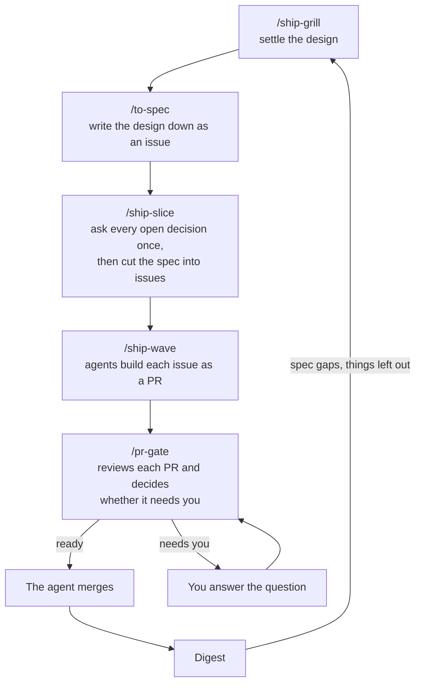

# ship-wave

**Settle the design. Agents ship the PRs. You answer the questions only you can answer, and read no diffs.**

ship-wave is five skills for Claude Code. You agree on a design in one conversation. An agent cuts it into small issues and asks you every open decision once, before anything is built. Agents then build each issue as its own PR in parallel, and a gate reviews each one and merges it. A PR reaches you only when the gate can write down a question only you can answer.

## Why

- Agents write PRs faster than you can review them. Reading every diff gives back the time they saved.
- Merging without reading is how a bad migration or an auth hole ships.
- Most PRs don't need you. The ones that do need a decision or a consent from you, not 400 lines of reading.

So the work is arranged to put your time at the start. Slicing is the heavy step: every decision and every consent is asked for there, once. A question that reaches a PR later is a gap the slicing left, and the digest lists it as one.

## What you see

A gate comment on a PR that needs you. This one is a made-up example from a shop app:

> **Needs you: 1 to answer** (repo setting `live`, head 3f9c2e1)
>
> **Why:** changes how refunds are paid back, and the issue doesn't say what happens to a refund larger than the charge.
>
> **Checks:** GitHub checks green; `pnpm test` 214 passed; `pnpm lint` clean.
>
> **Reviews:** sensitive, so two fresh-context reviewers. 1 blocking (a refund could be larger than the original charge), fixed with a test. Second reviewer: no findings.
>
> **Misses:** nothing runs against the live payment provider; the sandbox stands in for it.
>
> **Revert:** revert the squash commit.
>
> **Needs you:** A refund larger than the charge: reject it, or cap it at the charge? The PR rejects it. I recommend rejecting. `src/billing/refunds.ts` L41-L48.

A PR that doesn't need you says "Ready to merge: nothing to read", and the agent merges it.

At the end of a wave you get one digest, and it's the only thing you have to read:

> **Just merge:** none.
>
> **Needs you**
> - #212 Refunds: reject or cap a refund over the charge? (gate comment, refunds.ts L41)
>
> **Merged by the gate**
> - #208 Order list paging · #209 Order detail page · #210 Empty order list text · #211 Order list tests
>
> **Spec gaps:** #212's question reached a PR because its issue didn't settle it.
>
> **Left out:** #209's issue mentions CSV export, but its criteria don't. Your call whether it becomes an issue.
>
> **Recurring:** two PRs left `console.log` calls in. Proposed as the ESLint `no-console` rule, not a note to the agents.

## Before you use it

- **It runs in Claude Code, on GitHub.** The gate uses the GitHub CLI. The tracker can be Linear, GitHub Issues, Jira or a plain list.
- **It doesn't design for you.** The flow starts once you can say what a user will be able to do and how a test would prove it.
- **The gate is a set of rules the agent follows.** Branch protection that requires CI to pass is what makes them hard to get around. On a private repo on GitHub Free, there is none.
- **Agents never bypass a rule.** If your repo requires an approving review that an agent can't give, the gate labels a clean PR `ready-to-merge` and leaves the merge to you, with nothing to read. It never uses `--admin`.

## How it fits with other skills

- **[Matt Pocock's skills](https://github.com/mattpocock/skills)** cover the start: the design interview and the spec. ship-wave uses them as its first two steps, and its slicing skill builds on the rules of his `to-tickets`.
- **[Addy Osmani's agent-skills](https://github.com/addyosmani/agent-skills)** teach one agent how to do each engineering step well: spec, test, review, ship. ship-wave answers a different question: how many agents work at once, and which PRs need a person at all.

## Install

This repo holds five skills: `ship-grill`, `ship-slice`, `ship-wave`, `pr-gate` and `risk-paths`. Each is a folder with a `SKILL.md`. Copy them to where you want them:

- `~/.claude/skills/` to have them in every project
- `<repo>/.claude/skills/` to have them in one repo

The rest of the flow is Matt Pocock's skills, installed as a plugin that updates itself:

```
claude plugin install mattpocock-skills@claude-plugins-official
```

`pr-gate` needs the GitHub CLI (`gh`). `ship-slice` and `ship-wave` need `pr-gate` next to them, and `ship-wave` also needs `ship-slice` and the `pr` skill from Matt's plugin; if the engineering plugin is installed, it also uses its `debug` and `deploy-checklist` skills. Then run two things once in each repo: `/setup-matt-pocock-skills`, which asks which tracker you use, and `/risk-paths`, which asks whether anyone real uses the product and which paths are sensitive, and writes the file the gate reads.

## How a piece of work flows



> **Before the first wave, run two things once in each repo:**
> 1. `/setup-matt-pocock-skills` to say which tracker you use.
> 2. `/risk-paths` to say whether the product has real users and which paths are sensitive. Without it the gate treats the repo as `live`.

**1. Settle the design with `/ship-grill`.** This is Matt Pocock's `/grill-me` with one line added: it doesn't ask how to split the work into PRs, because `/ship-slice` decides that. It interviews you about what you want to build until the open questions are gone. Stop when you can say what a user will be able to do afterwards and how a test would prove it. `/ship-grill docs` is his `/grill-with-docs`, which also writes decision records and a glossary.

**2. Write it down with `/to-spec`.** It turns the conversation into a spec issue on your tracker, with no further interview. Every later agent works from issues, not from this chat, so the design has to leave the chat.

**3. Cut it into issues with `/ship-slice`.** This is where your time goes. It reads the spec and the code, then lists what only you can settle: decisions the spec leaves open, consents to anything a revert can't undo, and results nobody can check before real use. It asks them in one batch, each with options and a recommendation, and settles the technical choices itself. Then it shows you the cut once and publishes one issue per slice.

A slice is one outcome a user or a test can see, proved by one test, that a revert removes whole. It goes through every layer it needs; it is never "the database part" and then "the UI part". Size is not the test. Every issue has the same eight sections: parent, outcome, acceptance criteria, proving test, door (two-way or one-way), settled answers, out of scope, and blocked by. In a brand new repo the first issue is a walking skeleton, the smallest thing that builds, runs one path and passes CI.

**4. Run `/ship-wave` with the issue ids.** One agent per issue, each in its own git worktree, each producing a draft PR that does the issue's criteria and nothing else. The agent writes the issue's test first and sees it fail. On code with no tests, it first writes a test that pins the current behaviour. It never edits or skips an existing test: when a test and the issue disagree, it stops and reports. An issue that isn't one slice is not started; it goes back to `/ship-slice`. Ship-wave keeps the tracker up to date and lands PRs in dependency order.

**5. Every PR goes through `/pr-gate`.** Ship-wave runs this itself. The gate sends back a PR that isn't one slice, collects the evidence (check results, and screenshots of changed screens, which it judges itself), and runs a fresh-context review that reports only bugs, missed criteria, security holes and code the issue didn't ask for. Then it asks one thing: does this PR need you?

A PR needs you only in five cases:

1. **A decision the issue doesn't settle**: product behaviour a user would notice, including who can see or do what.
2. **Consent to something a revert can't undo**: spending money, publishing, changing an external system, and, once real people use the product, a migration that drops data, a changed public API, or a message or charge to real people.
3. **A change to the controls**: `CLAUDE.md`, `.claude/**`, CI workflows and the config of the checks; or a check weakened (a skipped test, a lowered threshold) that the issue didn't ask for.
4. **The gate is stuck**: three review rounds without settling a finding, or a check it can't run.
5. **A concern it couldn't settle**, when it can say what goes wrong, for whom, and why no check shows it.

Each one is written as a question you can answer in a sentence, with the options and a recommendation. There is no minimum and no maximum: often none, and never one made up. None of these alone is a reason to bring you a PR: a sensitive path, the size of the diff, a screen to look at, or the gate being unsure.

Everything else is labelled `ready-to-merge` and merged by the agent, which also rebases anything stacked on top. The verdict is recorded on the PR, so `/pr-gate land` can merge it later, once CI is green, without another review.

**6. Read the digest.** It opens with the PRs to just merge (if your repo needs your approval), then the questions that need you. Answer a question on the PR, on the issue or in chat; the gate applies the answer, re-reviews only the changed lines, and merges.

Run `/pr-gate` on its own only for a PR that didn't come from a wave: one you wrote by hand, or one from another tool.

### Writing `.claude/risk-paths.md`

The file has one `lane:` line and up to three sections. Paths are globs, one per bullet, in backticks. A note after ` - ` is for humans and is ignored by the gate.

```markdown
# Risk paths (read by the pr-gate skill)

lane: mvp

## sensitive
- `src/auth/**` - sign-in, sessions, permissions
- `src/billing/**` - anything that charges a card
- `migrations/**` - stored data shape
- `.github/workflows/**` - CI itself
- `package.json`
- `pnpm-lock.yaml`
- `.claude/**` - the rules agents follow, including this file

## needs-adr
- `migrations/**`
- `openapi.yaml`

## docs and tests
- `docs/**`
- `**/*.md`
- `tests/**`
- `**/*.test.*`
```

What each part does:

- **`lane:`** says what counts as a one-way door. It is `mvp` while nobody real is using the product: a revert undoes a change to stored data or an API, so the gate doesn't ask for consent to one. It is `live` once they are: a migration that drops or rewrites data, a changed public API and a message or charge to real people need your consent first. Leaving the line out means `live`.
- **`sensitive`** lists the paths where a mistake hurts: sign-in, user data, money, CI, deploy, dependency manifests and lockfiles, and the agent rule files. A PR touching one gets a second reviewer with a security lens, on a different model when one is available. A sensitive path does not by itself send a PR to you.
- **`needs-adr`** lists paths whose change needs a decision record. When a PR touches one without a `docs/adr/*.md` file, the implementer writes the record from the issue if the issue holds the decision; if it doesn't, that is a question for you.
- **`docs and tests`** lists what counts as a docs-or-tests-only change, which needs no reviewer. A PR is in that bucket only when every changed file matches here and nothing behaves differently.

`/risk-paths` writes the file with you: it asks whether anyone real uses the product, finds the candidate paths in the repo, asks what is missing and opens the file as its own PR. The file is one of the controls, so that PR comes to you. Until the file exists the gate uses the template in `skills/pr-gate/references/risk-paths-template.md` with `lane: live`.

## The skills in this repo

| Skill | What it does |
|---|---|
| `ship-grill` | Matt Pocock's `grill-me` (and `grill-with-docs` with `docs`), with one line added: leave splitting the work to `/ship-slice`. The interview is all his. |
| `ship-slice` | Cuts a spec into vertical-slice issues. Asks every decision and consent only you can give, in one batch, before cutting; then publishes one issue per slice to a fixed contract. |
| `ship-wave` | Leads a batch of issues to merged PRs. One sub-agent per issue, draft PRs, pr-gate on each in dependency order, tracker updates, one digest at the end. |
| `pr-gate` | Verifies a PR and decides whether it needs you. Collects evidence, runs the review, labels the PR `ready-to-merge` or `needs-you`, posts one gate comment with each question, merges what is ready and rebases what's stacked on it. |
| `risk-paths` | Writes `.claude/risk-paths.md` with you, once per repo: the setting and the sensitive paths the gate reads. |

## Skills from Matt Pocock's plugin

Not in this repo. They come from [mattpocock/skills](https://github.com/mattpocock/skills) via the plugin above; see [CREDITS.md](CREDITS.md). The ones the flow uses:

| Skill | Use it for |
|---|---|
| `grill-me` | Being interviewed about a plan until it's settled. `ship-grill` runs it with one line added. |
| `grill-with-docs` | Same, plus decision records (ADRs) and a glossary. `ship-grill docs` runs it. |
| `to-spec` | Writing the settled design down as a spec issue, no interview. |
| `prototype` | A throwaway prototype to settle a UI or state question. |
| `improve-codebase-architecture` | Finding the worst tangles in a messy codebase. |
| `wayfinder` | Work too big for one session, laid out as a map of decision tickets. |
| `setup-matt-pocock-skills` | The one-time setup per repo: tracker and labels. |

`grilling` and `domain-modeling` (which `ship-grill` calls), `codebase-design`, `research` and `pr` (the PR body template `ship-wave` uses) are helpers the skills above call. You don't run them yourself. His `to-tickets` is not used: `ship-slice` takes its place.

## Evals

`evals/` holds what each skill is expected to do, as tables, and a harness that checks it by running the skills headless against a fake GitHub CLI:

| Expectations | Checked by |
|---|---|
| `evals/gate-expectations.md` | `node evals/run.mjs gate` |
| `evals/slice-expectations.md` | `node evals/run.mjs slice` |
| `evals/build-expectations.md` | `node evals/run.mjs build` |
| `evals/flow-expectations.md` | `node evals/run.mjs flow` |

Every run is a real Claude Code session and costs tokens. See [evals/README.md](evals/README.md).

## Using the skills on claude.ai

Zip a skill folder (the folder itself at the zip root, no `__pycache__`), then upload it under Customize > Skills. To update one later: the skill > More options > Replace.

Matt's skills have to be zipped from [his repo](https://github.com/mattpocock/skills). They carry a `disable-model-invocation` line in their `SKILL.md`; remove it before uploading. claude.ai only accepts `name`, `description`, `license`, `compatibility`, `metadata` and `allowed-tools`.

## License

MIT, see [LICENSE](LICENSE). Matt Pocock's skills are his, under their own MIT license; see [CREDITS.md](CREDITS.md).
