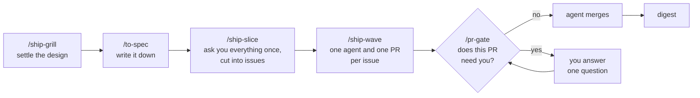
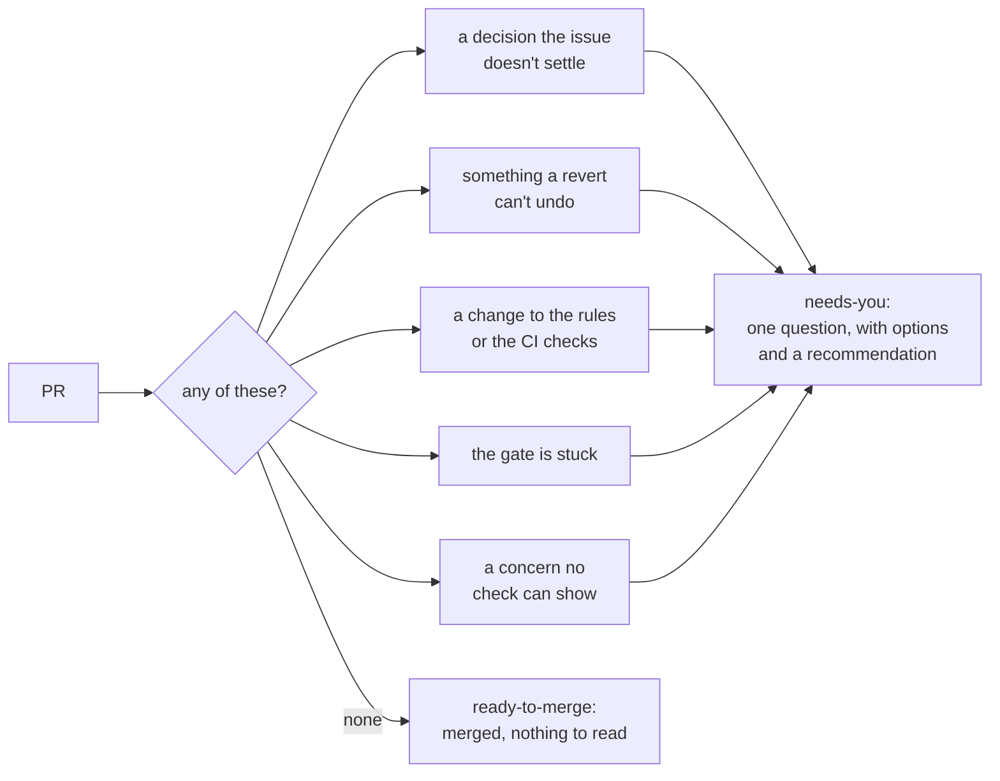

# ship-wave

**Settle the design. Agents ship the PRs. You answer the questions only you can answer, and read no diffs.**

Five skills for Claude Code.

<p align="center">
  
</p>

<sub>An example session with a made-up shop app, not a recording.</sub>

## The flow



Your time goes in at `/ship-slice`. After that, a PR reaches you only as a question.

## When a PR needs you



A big diff, a sensitive path or an unsure gate is never a reason on its own.

## Install

```
git clone https://github.com/freshmick/ship-wave
cp -r ship-wave/skills/* ~/.claude/skills/
claude plugin install mattpocock-skills@claude-plugins-official
```

Then once per repo: `/setup-matt-pocock-skills` and `/risk-paths`. Details in [docs/install.md](docs/install.md).

## The skills

| Skill | What it does |
|---|---|
| [`ship-grill`](skills/ship-grill/SKILL.md) | Interviews you until the design is settled. |
| [`ship-slice`](skills/ship-slice/SKILL.md) | Asks every decision only you can make, once, then cuts the spec into issues. |
| [`ship-wave`](skills/ship-wave/SKILL.md) | Runs one agent per issue and lands the PRs in order. |
| [`pr-gate`](skills/pr-gate/SKILL.md) | Reviews each PR, merges it or writes you a question. |
| [`risk-paths`](skills/risk-paths/SKILL.md) | Tells the gate which paths are sensitive, once per repo. |

## Good to know

- Runs in Claude Code, on GitHub (needs `gh`). The tracker can be Linear, GitHub Issues, Jira or a plain list.
- It doesn't design for you. Start once you can say what a user will be able to do and how a test would prove it.
- The gate is rules an agent follows. Branch protection that requires CI is what makes them hard to get around.
- Agents never bypass a rule. If your repo needs an approval they can't give, they label the PR and you merge it, unread.

## More

- [How it works](docs/how-it-works.md): the six steps, with an example gate comment and digest
- [Install and setup](docs/install.md): dependencies, Matt Pocock's skills, claude.ai
- [Risk paths](docs/risk-paths.md): the file the gate reads
- [Evals](evals/README.md): what each skill is expected to do, and the harness that checks it
- [Credits](CREDITS.md): built on [Matt Pocock's skills](https://github.com/mattpocock/skills); MIT, see [LICENSE](LICENSE)
